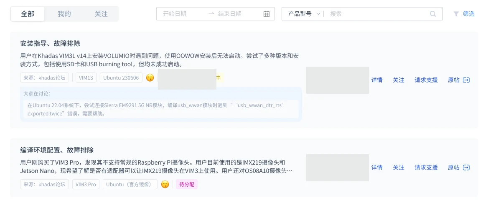
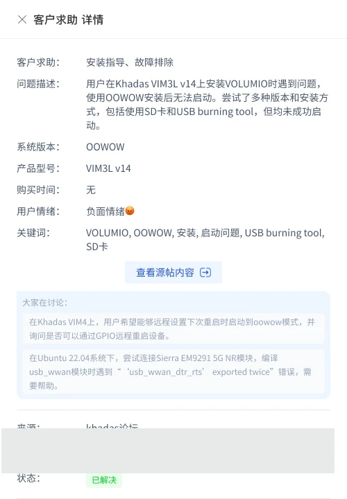
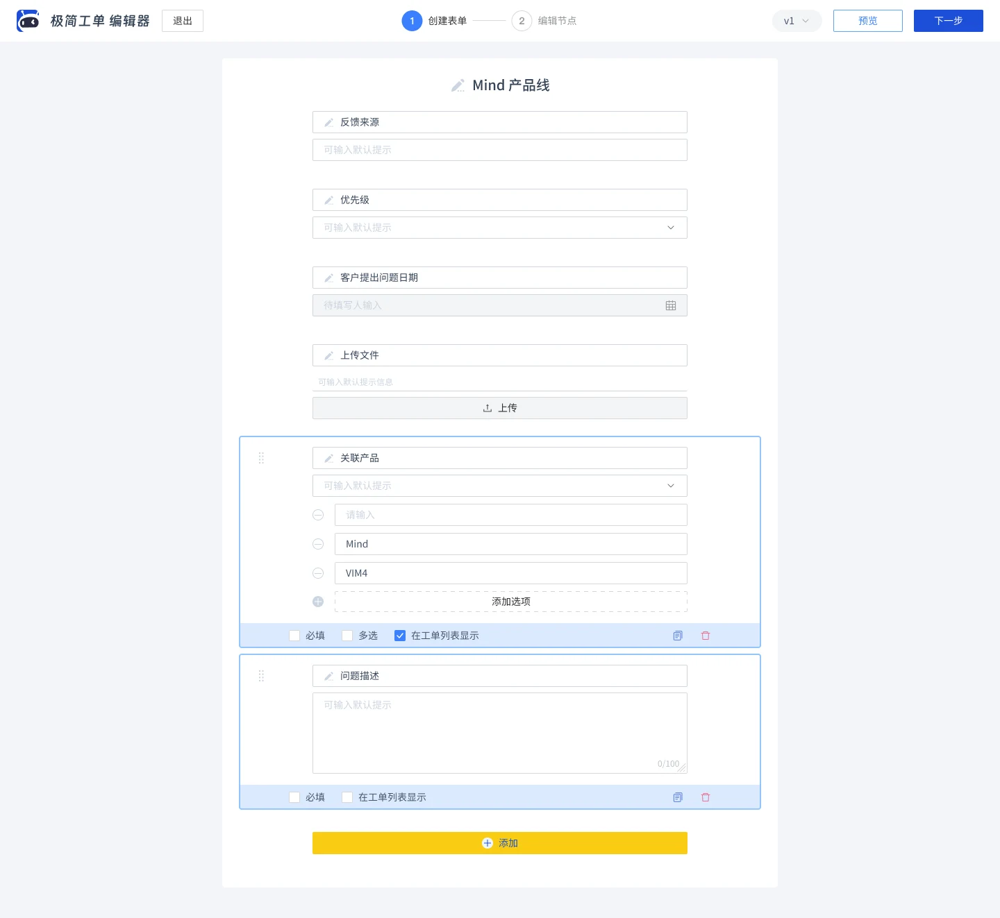
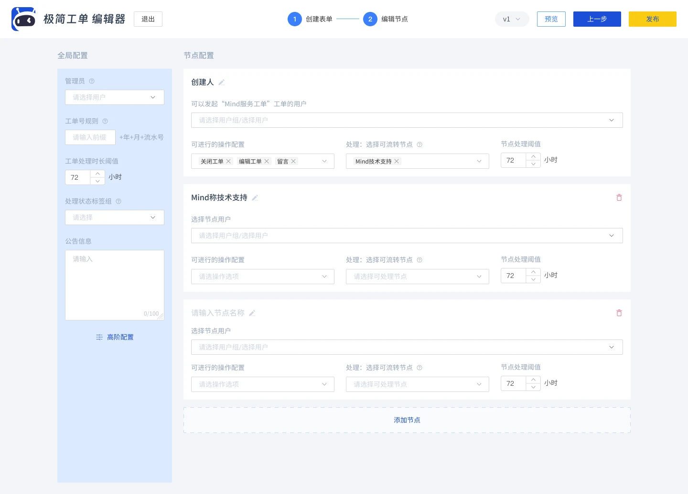
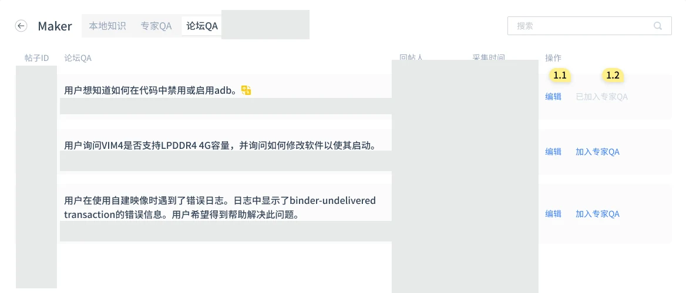
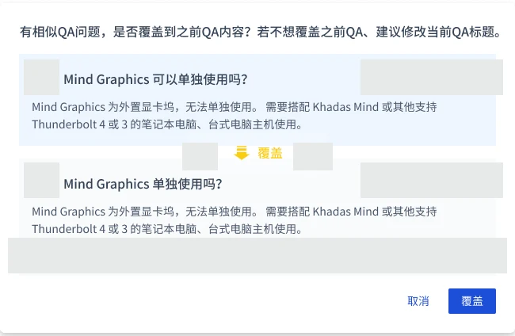

## 从回答问题，到支持业务

**AI 给出答案之后，谁来判断、谁来处理、谁来维护？** 这是 WeC Bot 从知识问答延伸到业务协作时，我持续关注的问题。论坛讨论、售后记录和内部知识分别承载不同的信息，不能只用一个聊天入口解决所有需求。

我围绕三个场景设计产品规则：论坛分析帮助人识别问题，工单组织后续行动，知识维护让处理经验有条件地复用。它们共同服务业务，但不代表已全部自动串联。

01 / 论坛分析<strong>回复，不等于解决</strong>
区分信息分类、人工响应和问题解决，保留原帖上下文。

02 / 售后工单<strong>留言，不等于转交</strong>
将信息补充和责任流转分开，明确每一步由谁继续处理。

03 / 知识维护<strong>回答，不等于入库</strong>
即时答疑与知识审核分开，避免未经确认的回答反复传播。

## 我的角色与产品演进

团队由**架构师、产品兼设计、两名开发**组成。我负责业务调研、产品规划、UX/UI、Prompt、论坛分析规则，以及毕昇工作流搭建与调试；架构、系统集成和工程实现由团队协作完成。

设计版本体现了产品重心的扩展：**1.x 知识问答与 QA 治理 → 2.x 论坛分析与审核探索 → 3.x—4.0 表单、流程与权限配置 → 5.0 智能客服探索**。这是设计迭代脉络，不作为各版本全面上线的时间表。

我的核心工作是把需求转成可以实现和检查的约束：输出哪些字段，状态如何改变，谁能操作，异常交给谁，以及哪些内容可以再次被 AI 使用。

## 论坛分析：从讨论中识别行动

### 按业务任务组织信息

同一篇帖子可能包含故障、购买咨询和产品建议，摘要本身不能决定下一步。我将分析拆为客户求助、商机线索与产品反馈／用户洞察，分别设计 Prompt、提取字段和结果结构。

| 业务视角 | 组织的信息 | 后续行动 |
| --- | --- | --- |
| 客户求助 | 产品、系统版本、问题描述、关键词 | 核对原帖，分配支持人员 |
| 商机线索 | 意向类型、需求摘要、跟进建议 | 人工判断是否有真实意向 |
| 产品反馈 | 使用感受、期望建议、问题背景 | 判断是否进入需求或问题池 |

缺失信息应明确表达，不能让模型补全成事实。卡片与详情保留原帖入口；相关讨论帮助补充线索，但不能代替当前帖子的上下文。

<figure class="case-evidence">

<figcaption><b>原始设计稿 · 局部脱敏</b>卡片把问题、产品环境、处理状态与请求支援放在一起；姓名与业务时间已遮盖。 点击查看大图。</figcaption>
</figure>

### 关键判断：有人回复，不等于问题解决

设计将状态拆成 **待分配 → 处理中 → 已响应 → 已解决**。分配人员进入处理状态，检测到回复才标记响应；解决状态依据原帖的“已解决”标记，而不是模型对语气的推测。Bot 自动回复也不直接视为解决。

请求支援、关注和处理记录承接人工协作。后续版本设计了转为工单的入口；本次实际页面观察中，工单样本来源为手动创建，因此不将这一入口描述为已经验证的自动联动。

<figure class="case-evidence">

<figcaption><b>原始设计稿 · 局部脱敏</b>详情保留产品与系统环境、信息缺失提示和来源入口，便于人工复核。图中问题为原设计样例。 点击查看大图。</figcaption>
</figure>

**业务观察：** 论坛分析已有业务使用记录。2026 年回看时，也发现相近重复结果和部分故障被判为销售机会的情况。下一步应复核分类边界与去重规则，不能把生成条数当作有效商机数。

## 售后工单：配置流程，明确责任

### 把不同业务的需求拆成表单与节点

售后与询盘需要不同字段和处理角色。设计从具体流程逐步抽象为两步配置：**先定义收集什么，再定义交给谁处理**，以适应不同产品线。

表单支持输入、选择、日期与附件，配置必填、多选及列表重点展示。详情区分系统信息、重点信息与其他表单内容，让处理人先看到判断所需信息。

<figure class="case-evidence">

<figcaption><b>原始设计稿 · 局部脱敏</b>第一步创建表单：配置业务字段，选择哪些信息在工单列表突出展示，并提供预览入口。 点击查看大图。</figcaption>
</figure>

节点进一步定义可操作人员、允许动作、可流转的下一节点与处理时限；全局配置承载管理员、编号规则与状态标签。角色权限从特定业务规则逐步转向可配置结构。

<figure class="case-evidence">

<figcaption><b>原始设计稿 · 局部脱敏</b>第二步编辑节点：将处理角色、允许操作与下一节点放在同一视图。时限为设计配置示例，不是实际处理绩效。 点击查看大图。</figcaption>
</figure>

### 关键判断：补充信息，不应隐式转移责任

**“处理”可以转交责任人，“留言”只补充记录与通知，不自动改变当前责任人。** 这一差异让协作中的“谁知道了”和“谁要继续做”保持清晰。日志保留创建、转交、说明与附件；关联工单支持选取已有记录或新建。

工单流转依赖确定的业务规则，AI 的作用主要在信息整理与辅助判断。2026 年 11 月的实际页面仍有新增、转交和关闭记录，说明工单持续被使用；没有改造前的测量基线，不宣称具体节时比例。

## 知识维护：让答案可追溯、可更新

### 将答案来源与维护责任一起设计

问答设计区分专家 QA、检索到的文档参考和模型生成回答，优先复用已整理的 QA，并通过来源提示帮助用户判断可信范围。知识库配置维护负责人，QA 权限与所属知识库关联；无法解决或需要纠正的问题可以进入答疑流程。

### 关键判断一：即时答疑与知识入库分开

迭代中，我将回复与入库拆成两种动作：**“仅回复”处理当前问题；“回复并入库”进入对应知识库的审核流程。** 由知识库负责人确认内容，负责人本人处理时可直接入库，避免所有临时回答都成为后续答案依据。

论坛 QA 也需要有控制地转为专家 QA：记录来源帖 ID、防止重复加入，并保留编辑入口。转入后两份内容可以独立编辑，因此版本一致性仍是后续维护需要关注的问题。

<figure class="case-evidence">

<figcaption><b>原始设计稿 · 局部脱敏</b>将论坛中的答疑沉淀为专家 QA，是有权限与重复检查的维护动作，不等同于模型自动学习。来源链接、人员和时间已遮盖。 点击查看大图。</figcaption>
</figure>

### 关键判断二：相似性检查必须尊重知识边界

入库或编辑时，设计只在**当前知识库内**检查相似问题，避免跨越权限覆盖其他知识。命中相似内容后，维护人可以核对已有答案，选择覆盖形成新版本，或取消并调整问题标题。

<figure class="case-evidence">

<figcaption><b>原始设计稿 · 局部脱敏</b>相似性检查辅助维护人作决定；设计阈值不是测得的准确率。头像、时间与反馈统计已遮盖。 点击查看大图。</figcaption>
</figure>

知识版本保留历史，停用内容不再参与 Bot 检索与相似性检查。这些规则把“能否找到答案”扩展为“这个答案是否仍应被使用”。

**业务观察：** 实际界面有专家 QA 更新、论坛 QA 与待回复记录。但反馈到审核、发布再到回答变化的整条路径仍需逐项验证；不据此宣称已实现自动纠错或完整模型评测体系。

## 交付、验证与复盘

| 主线 | 我的主要交付 | 已有使用依据与边界 |
| --- | --- | --- |
| 论坛分析 | 分析任务、Prompt、字段规则、工作流、状态与协作设计 | 已有业务使用；分类质量与重复问题仍需复核 |
| 售后工单 | 调研、表单、节点、权限、交互及日志设计 | 持续新增、转交与关闭记录；不等于 AI 自动处理 |
| 知识维护 | 知识范围、助手工作流、QA 审核与版本规则 | 有维护与答疑记录；完整质量闭环仍需验证 |

这次实践让我更明确：**产品价值不只在于让 AI 输出内容，也在于为输出安排使用者、责任与维护机制。** 下一步优先做三件事：复核论坛分类与去重；以完整样本检查工单责任流转；验证知识更新后的回答变化，并建立新的测量基线。

智能客服、合同审核与 WeCCoin 激励属于相关设计探索。其中智能客服按内部及邀请试用呈现，不与核心场景的业务使用混为一谈。

> 资料说明：页面以原始设计稿及其业务注释重构，截图为设计稿局部，不代表功能已全部上线；使用状态另依据实际页面与既有项目记录。素材于 2026-11-12 核对，公开图已在本地永久遮盖敏感信息。设计示例、配置阈值与界面统计均不作为业绩指标。
