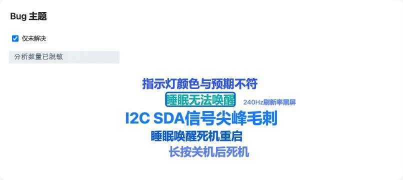
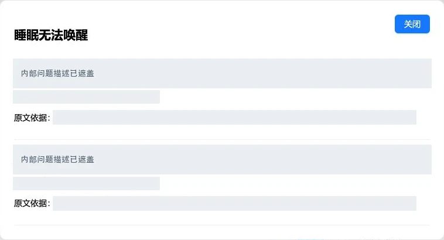

<strong>持续开发中</strong> · 阶段记录更新于 2026 年 11 月 12 日

## 公司数字化的瓶颈

公司的业务信息大量沉淀在 Excel 中，另有 Microsoft Lists 等记录。表格方便各部门维护，但文件之间缺少统一关联：同一产品可能使用不同名称，不同表格有不同结构，管理者要理解一个项目，仍需跨文件查找、核对和拼接信息。

**我的切入点是把分散记录变成可共同使用的数据基础。** 保留已有维护入口，在中台建立统一接入、解析、身份映射与追溯机制，再让业务应用读取可解释的数据。

瓶颈 01<strong>文件分散</strong>
同一产品的信息存在多份表格与业务列表中，难以一起查看。

瓶颈 02<strong>口径不一</strong>
产品别名、表头、单位与统计方式不同，直接汇总容易误读。

瓶颈 03<strong>更新难追溯</strong>
数据何时采集、来自哪一行、失败后是否仍是旧值，需要明确展示。

## 我的方案：统一数据源，复用到应用

我主导场景选择、数据与业务规则、信息架构和交互设计，借助 Codex 推进实现、调试与验证。统一数据源的核心是让同一份来源有明确身份、解析规则和更新状态，让不同应用复用；业务人员继续在原有工具中维护相应事实。

现有维护入口<strong>Excel · Microsoft Lists</strong>
业务部门维护原始记录

WESION 数据基础<strong>接入 → 解析 → 身份关联</strong>
来源配置 / 标准产品 ID / 成功快照 / 原文追溯

应用复用<strong>Bug／VOC · 销售 · ROADMAP</strong>
按场景组织分析、筛选与跟进

架构示意 · 会议助手另有音频与文本输入，确认后的事项进入 Todo 流程，并可关联标准产品。

| 我的产品判断 | 落到产品中的处理 |
| --- | --- |
| 来源只接一次，应用分别使用 | 同一文件可配置多个 Sheet，下载后分别解析；来源可关联多个应用，避免重复维护多套接入配置 |
| 产品名称需要稳定身份 | 建立产品主表与标准 ID，保留别名及原始名称；无法确定的匹配不猜填 |
| 先看解析结果，再启用业务判断 | 配置表头、字段和解析规则，预览匹配结果并抽查原表；规则待复核时先展示事实 |
| 失败与零数据必须区分 | 保留最近成功快照，同时展示采集时间、失败状态和原始来源 |

当前已有来源配置、产品映射及部分应用读取快照的实现与验证记录。**跨应用口径一致性、复杂表格解析和业务验收仍在持续完善**，不将其描述为公司全部数据已经完成统一治理。

## 应用案例

下面按业务场景切换阅读。各模块共享平台基础，但输入、AI 的作用和验证阶段分别说明。

<button type="button" id="tab-bug" role="tab" aria-controls="module-bug" aria-selected="true">Buglist / VOC</button>
<button type="button" id="tab-meeting" role="tab" aria-controls="module-meeting" aria-selected="false" tabindex="-1">会议助手</button>
<button type="button" id="tab-sales" role="tab" aria-controls="module-sales" aria-selected="false" tabindex="-1">销售数据治理</button>

<section id="module-bug" data-case-panel aria-labelledby="tab-bug">

## Bug／VOC：从主题回到依据

### 把模型任务限定在问题整理

输入是已有记录的标题与描述，输出是简短的问题主题和对应原文片段。AI 帮助组织文本，不自动判断根因，也不替业务负责人修改优先级或处理状态。

一条记录可能包含多个问题，因此允许关联多个主题；主题涉及数量不能直接相加当作独立问题总数。待确认结果不直接进入词云，避免把未确认的分析当成确定结论。

<b>读取记录</b>标题与描述<b>提取主题</b>模型辅助整理<b>校验依据</b>连续原文片段<b>人工核对</b>打开关联记录

流程示意 · 说明机制，不代表效果评测结果

<figure class="case-evidence"><figcaption><b>01 / 先理解主题，再进入记录</b>2026-11-12 读取的 Bug 页面局部。保留通用问题主题及筛选控件，分析数量已脱敏。截图说明界面路径，不用于证明准确率或业务收益。点击可查看大图。</figcaption></figure>

### 原文引用可验证，语义正确仍需评测

模型给出的依据需要是输入中的连续原文片段，无法通过校验的结果不作为正常主题展示。这能约束“编造引用”，但**原文存在并不等于主题概括准确**：错误归类、过度合并和遗漏问题仍需要人工样本评测。

点击主题后，界面展示关联记录、所属项目与状态、原文依据，让读者能够检查概括是否成立。本版以 Bug 界面展示这条交互路径；VOC 的机制依据产品文档与实现记录说明，尚待补充单独的使用验证。

<figure class="case-evidence"><figcaption><b>02 / 让概括有可检查的来源</b>真实界面局部，经本地裁剪与永久遮盖。内部问题描述、项目、数量及原文内容不公开；灰色区域与脱敏说明为后期处理，不是产品原有内容。</figcaption></figure>

## 从一次调用到可持续运行

调用模型只是开始。我把“何时分析、哪些需要重算、失败如何恢复、谁可以使用”拆成明确的产品规则，并借助 Codex 推进实现。

| 关键判断 | 当前机制 | 解决的问题与边界 |
| --- | --- | --- |
| 浏览不等于发起分析 | 首次分析显式触发；浏览、筛选或保存配置不直接调用模型 | 避免用户无感触发处理与消耗 |
| 内容变化才需要重算 | 首次分析后对新增或标题、描述变更的记录增量处理；负责人、状态等变化复用缓存 | 减少重复处理；尚未量化实际节省 |
| 失败不能覆盖已有成果 | 保留成功结果，重试未完成部分；全量更新需确认，并以开始时的数据快照处理 | 避免局部失败导致整批成果不可用 |
| 长任务需要恢复能力 | 持久化任务与进度，支持中断后恢复 | 已有机制与测试记录；不等同于长期稳定性承诺 |
| 用量与权限分别管理 | 应用级每日调用／记录配额，用量记录；AI 配置权限与业务数据访问分离 | 配额并不等于人民币预算，配置权限不自动获得业务数据权限 |

这些机制已有代码与自动化测试记录支持。其中模拟模型的测试验证缓存、重试和依据校验等行为，**不能代替真实模型的质量评测**。完整业务验收与真实模型评测仍需持续补充。

</section>

<section id="module-meeting" data-case-panel aria-labelledby="tab-meeting">

## 会议助手：从讨论到可确认的行动项

会议内容需要从录音与讨论转成摘要、责任人、期限和后续跟进。这里的重点是区分“AI 提出的候选事项”与“人已确认、可以提交的任务”，并为识别错误和中断保留恢复路径。

<b>录音与转写</b>保留音频和识别文字<b>生成摘要</b>共识、Todo 与遗留事项<b>人工确认</b>内容、负责人及期限<b>事项跟进</b>关联来源会议

流程示意 · 功能的可用范围以本节阶段说明为准

### 我关注的产品判断

- **识别结果可以纠正。** 转写精修先预览、采用后替换，保留原文恢复；重新生成摘要需提示替换，避免覆盖人工确认内容。
- **人名不是可靠的账号身份。** 识别的人名需要从人员目录确认；创建者应为当前登录人，不回退成后台应用身份。
- **建议不自动成为承诺。** 事项正文必填，负责人、期限与验收方允许暂缺；不由模型猜填，不把未明确的讨论包装成确定任务。
- **任务需要保留上下文。** Todo 关联来源会议，可选关联标准产品；通过期限、负责人和状态组织后续查看。
- **恢复不等于自动继续。** 草稿可恢复，但刷新中断的录音或生成任务不能假装仍在进行；本地录音草稿也不等于服务器共享录音。

### 当前阶段与不足

截至 2026-11-12，产品验证记录记载：用 **21 秒合成测试音频**完成真实转写、AI 摘要及单条 Todo 创建，并核对创建者与负责人身份。这只证明该次文件音频链路跑通，尚不能证明长会议、多人识别或长期业务使用的可靠性。

**正式长期提交尚未开放。** 提交取决于当前用户授权、目标列表权限、字段准备和环境开关。真实麦克风长录音、停止收尾、多人识别与其他用户身份核验仍需补齐。本版先用流程示意说明设计，后续再补可公开的脱敏界面与真实任务反馈。

</section>

<section id="module-sales" data-case-panel aria-labelledby="tab-sales">

## 补充：销售数据治理

销售分析采用确定性业务规则整合 7 张来源表，提供筛选、下钻和来源追溯。这里体现的是数据产品能力；Codex 辅助实现，不把数据汇总包装成模型洞察。

**先定义缺失与换算，再计算总数。** 缺失值不等于零；金额与数量独立处理，保留负值。优先使用有效人民币原值，只有条件齐备时才按币种与月份汇率补算，并保留计算依据。

**先确认产品身份，再合并统计。** 原始型号与归一后的产品分类保留关联，相似名称不直接自动合并；冲突需要显式处理。汇总行与明细不重复累计，Excel 与 ERP 口径分开呈现。

**让异常与来源一起可见。** 保留来源文件、工作表、行位置及原始值。采集失败时继续展示上次成功快照，同时说明更新时间和异常，避免旧数据被误认为刚刷新成功。来源数据保持只读。

这部分仍在持续完善映射、数据质量检查与业务对账，本版以规则说明为主，后续补充可公开的脱敏对账样例。

</section>

## 当前证据与待补验证

| 能力 | 当前能说明什么 | 还不能据此断言什么 |
| --- | --- | --- |
| AI 应用设计 | 主题提取、原文关联、异常处理有具体产品规则 | 不能直接推导主题准确率或用户满意度 |
| 产品实现 | 页面可读取，Bug 主题至原文路径已查看；缓存、重试等机制有实现记录 | 不能代表全部模块完成上线验收或长期稳定运行 |
| 数据治理 | 销售来源、缺失、换算、映射和追溯有明确规则 | 不能代表所有来源与统计结果已经业务签字验收 |
| 成本与效果 | 有调用约束及部分用量记录，可继续建立评测 | 尚无同条件模型对比、完整费用核算或可归因的效率收益 |

目前最明确的进展，是将分散文件接入统一的数据基础，再围绕具体业务构建有来源、可核对的应用。下一步需要用样本和真实任务检验它是否足够准确、值得持续使用。

## 下一步：用证据推进迭代

1. **建立人工标注样本。** 分别覆盖 Bug 与 VOC，记录主题相关性、遗漏、错误合并和原文支撑情况。先确定判定标准，再比较 Prompt 或模型版本。
2. **做一次同条件对比。** 固定任务、样本与日期，同时记录质量、耗时、失败率与真实用量，避免仅凭回答观感选模型。
3. **跟踪一个真实使用场景。** 记录业务人员怎样核对主题、发现了什么错误、是否用于后续讨论，并保留修改前后证据。

以上是待开展的验证计划，不是已取得的成果。后续新增功能、使用反馈与评测结果，会按日期持续更新本页；新的测量只说明当次条件下的表现，不用于反推历史收益。
